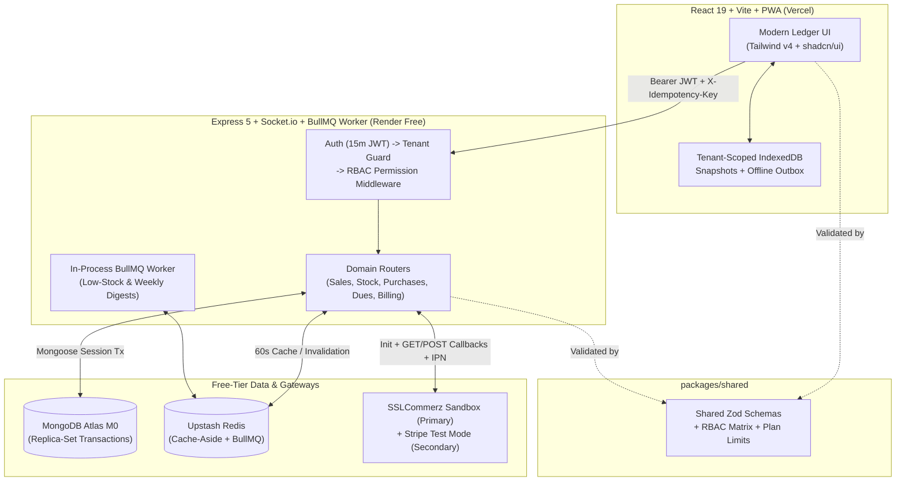

# DokanOS Architecture & Key Engineering Decisions

This document provides a detailed overview of the system architecture, technical design patterns, and engineering decisions implemented in DokanOS.

---

## 1. System Architecture

DokanOS is designed with a service-oriented monorepo layout that splits the frontend, backend, and shared typings/validation schemas into distinct npm packages under the `@dokanos` scope.



---

## 2. Key Engineering Decisions

### 1. Row-Level Multi-Tenancy (`tenantId` on every model)
Every Mongoose collection (`Product`, `StockMovement`, `Sale`, `Purchase`, `Supplier`, `DuePayment`, `Payment`, `Subscription`, `Notification`, `AuditLog`) carries a required `tenantId` indexed as the leading key of compound indexes:
- `{ tenantId: 1, sku: 1 }`
- `{ tenantId: 1, invoiceNo: 1 }`
- `{ tenantId: 1, createdAt: -1 }`

The `requireTenant` middleware resolves `req.tenant` from the verified JWT claim and rejects any spoofed `X-Tenant-Id` header with `403 TENANT_MISMATCH`.

### 2. In-Memory Access Tokens & Rotating Refresh Tokens
Access tokens (15-minute JWT) are held strictly in a Zustand memory store (`authStore.ts`) and never saved to `localStorage` or `sessionStorage` to mitigate XSS attacks. 
30-day opaque refresh tokens are stored as SHA-256 hashes in MongoDB (`RefreshTokenModel`) and sent via an `httpOnly`, `SameSite=Lax` cookie (`dokanos_rt`). Every `/api/v1/auth/refresh` rotates the token within its `familyId`. Presenting an already rotated token triggers family reuse detection and revokes the entire `familyId` instantly.

### 3. Atomic Stock & Money Mutations via Transactions
Creating or returning a sale, receiving a supplier purchase, and recording Baki credit payments run inside `mongoose.startSession()` transactions. Stock decrements use an atomic MongoDB filter paired with `$inc`:
```javascript
{ _id, tenantId, isActive: true, stock: { $gte: qty } }
// $inc: { stock: -qty }
```
This guarantees stock never goes negative even under high concurrency or parallel POS terminal rings.

### 4. Pluggable `BillingProvider` Seam
Both `SslCommerzBillingProvider` (primary BDT sandbox gateway) and `StripeTestBillingProvider` (secondary test mode) implement a unified `BillingProvider` interface:
```typescript
interface BillingProvider {
  createCheckout(tenantId: string, plan: string): Promise<CheckoutSession>;
  handleWebhook(payload: any, signature?: string): Promise<WebhookResult>;
  getSubscription(subscriptionId: string): Promise<SubscriptionDetails>;
}
```
Prepaid periods (30-day "Pro") are atomic, where database IPNs and redirects validate the transactions and update `{ status: 'pending' } -> { status: 'paid' }` guarded by a unique `{ provider, eventId }` index so replays never double-extend or cause double-spend issues.

### 5. In-Process BullMQ Workers
To run on free-tier Render instances without requiring extra paid worker background dynos, BullMQ workers (`daily-low-stock-digest`, `weekly-sales-summary`, `subscription-expiry-sweep`) run in-process alongside Express whenever `UPSTASH_REDIS_URL` is configured, failing over to direct inline execution if Redis is omitted.

### 6. Scoped PWA Offline Outbox
Service workers precache the app shell, and IndexedDB stores tenant-scoped product and Baki snapshots (`{tenantId}:{resourceKey}`). Sales queued while offline use client-generated `idempotencyKey` enforced by a partial unique index on `Sale` and `DuePayment`, protecting the system from double-sync replay effects.

---

## 3. Folder Structure Overview

```text
DokanOS/
├── apps/
│   ├── api/             # Express 5 backend server & domain models
│   │   ├── src/
│   │   │   ├── middleware/   # Auth, tenant, rate limits, RBAC, Pino
│   │   │   ├── modules/      # Sales, Stock, Dues, Purchases, Auth routes
│   │   │   ├── models/       # Mongoose schemas & indexes
│   │   │   └── server.ts     # Server bootstrapper & database session initialization
│   │   └── tests/            # API integration, isolation, & concurrency suites
│   └── web/             # React 19 + Vite frontend application
│       ├── src/
│       │   ├── components/   # Tailwind v4 & shadcn/ui shared components
│       │   ├── store/        # Zustand client state (auth, offline-sync)
│       │   └── pages/        # Dashboard, POS, Baki, Purchase ledger UI
│       └── public/
└── packages/
    └── shared/          # Shared validation schemas (Zod), RBAC configs, & plan limits
```
