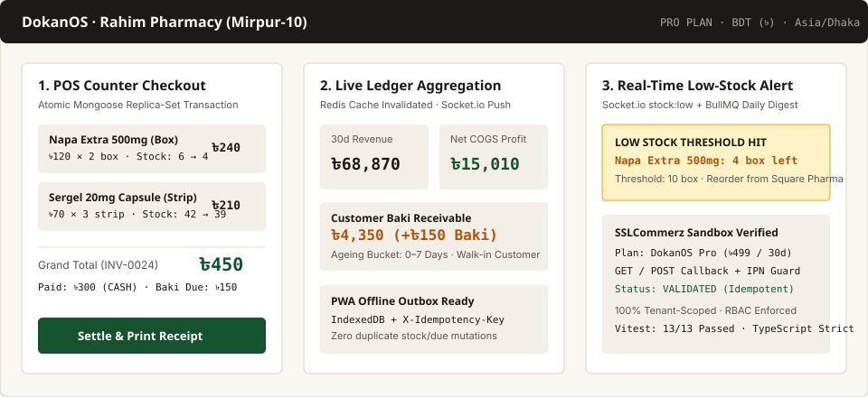
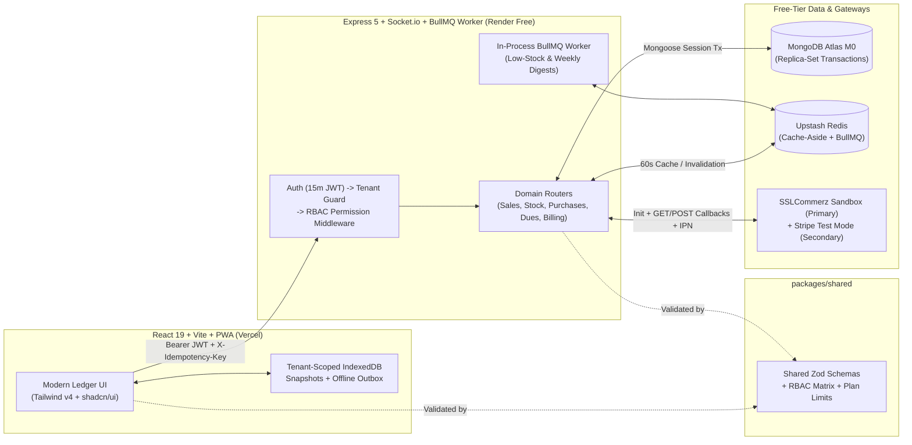

# DokanOS — Multi-Tenant Inventory, POS & Baki (Credit) SaaS for Bangladeshi Retail Shops




---

## 1. What It Is

**DokanOS** is a multi-tenant inventory, counter point-of-sale (POS), supplier purchase order, and **Baki** (customer receivable / supplier payable credit) ledger SaaS built for small Bangladeshi retail shops—pharmacies, neighbourhood groceries (*mudi dokan*), and electronics stores.

### Live Demo & Credentials

- **Live Web App (Vercel):** `https://dokanos-web.vercel.app` *(or run locally with `pnpm dev` / preview at the AI Studio URL)*
- **Live API Health (Render Free):** `https://dokanos-api.onrender.com/health`
- **One-Click Demo Shop:** Click **"Try the demo shop"** on `/` or `/login` to sign directly into **Rahim Pharmacy (Mirpur-10, Dhaka)**—a pre-seeded Pro-plan pharmacy with 22 products, 3 suppliers, 45 days of sales history, and 8 open Baki accounts.
- **Demo Accounts:**
  - **Owner:** `demo@dokan-os.demo` / `Demo1234!`
  - **Manager:** `manager@dokan-os.demo` / `Manager1234!`
  - **Counter Staff:** `staff@dokan-os.demo` / `Staff1234!`

> **Free-Tier Wake-Up Note:** *First load may take up to a minute — the free server wakes up.* (Hosted on Render Free Web Service + Vercel Hobby + MongoDB Atlas M0 + Upstash Redis Free).

---

## 2. Why I Built It

Across Bangladesh, millions of neighbourhood pharmacies and retail shops still record daily sales and customer credit (*Baki*) in paper *khata* notebooks. Existing enterprise ERP tools are priced in USD, assume barcode-scanner hardware, and fail when shop internet drops for a few minutes.

DokanOS solves the three hardest operational problems for a single-counter or multi-staff Bangladeshi shop:
1. **Zero negative stock under concurrent counter sales:** Multiple staff ringing up the last medicine box simultaneously cannot oversell inventory.
2. **Unified Baki ageing ledger:** Customer credit sales and supplier purchase-order balances are tracked in one place with `0–7`, `8–30`, and `30+` day ageing buckets in Bangladeshi Taka (`৳`).
3. **Resilient offline counter & Baki outbox:** Temporary shop network outages do not halt the counter—POS sales and Baki collections queue locally in IndexedDB with client-generated idempotency keys and replay safely on reconnect.

---

## 3. Architecture & Key Engineering Decisions



### Key Engineering Decisions

1. **Row-Level Multi-Tenancy (`tenantId` on every model):**
   Every Mongoose collection (`Product`, `StockMovement`, `Sale`, `Purchase`, `Supplier`, `DuePayment`, `Payment`, `Subscription`, `Notification`, `AuditLog`) carries a required `tenantId` indexed as the leading key of compound indexes (`{ tenantId: 1, sku: 1 }`, `{ tenantId: 1, invoiceNo: 1 }`, `{ tenantId: 1, createdAt: -1 }`). The `requireTenant` middleware resolves `req.tenant` from the verified JWT claim and rejects any spoofed `X-Tenant-Id` header with `403 TENANT_MISMATCH`.
2. **In-Memory Access Tokens + Rotating Refresh Token Families with Reuse Detection:**
   `15m` JWT access tokens are held strictly in a Zustand memory store (`authStore.ts`)—never in `localStorage` or `sessionStorage`. `30d` opaque refresh tokens are stored as `SHA-256` hashes in MongoDB (`RefreshTokenModel`) and sent via an `httpOnly`, `SameSite=Lax` cookie (`dokanos_rt`). Every `/api/v1/auth/refresh` rotates the token within its `familyId`; presenting a previously rotated token triggers reuse detection and immediately revokes the entire `familyId`.
3. **Atomic Stock & Money Mutations via MongoDB Transactions:**
   Creating a sale (`POST /api/v1/sales`), returning a sale (`POST /api/v1/sales/:id/return`), receiving a supplier purchase (`POST /api/v1/purchases`), and recording a Baki payment (`POST /api/v1/dues/:refId/payments`) run inside `mongoose.startSession()` transactions. Stock decrements use an atomic filter (`{ _id, tenantId, isActive: true, stock: { $gte: qty } }`) paired with `$inc: { stock: -qty }`, guaranteeing stock never goes negative even under parallel requests.
4. **Pluggable `BillingProvider` Seam + Idempotent Webhook & Browser Callback Handling:**
   Both `SslCommerzBillingProvider` (primary BDT sandbox gateway) and `StripeTestBillingProvider` (secondary test mode) implement a single `BillingProvider` interface (`createCheckout`, `handleWebhook`, `getSubscription`), alongside a documented `501 NOT_CONFIGURED` `BkashStubBillingProvider` detailing the 5-step bKash tokenized checkout flow. Because local Bangladeshi gateways do not offer native recurring billing to small merchants, Pro is modeled as a **30-day prepaid period (`planExpiresAt`)**. Both `POST` IPNs and `GET` browser redirects on `/api/v1/billing/sslcommerz/success` validate the transaction and perform an atomic `{ status: 'pending' } -> { status: 'paid' }` update guarded by a unique `{ provider, eventId }` index so replays never double-extend `planExpiresAt`.
5. **In-Process BullMQ Worker + Redis Cache-Aside (`60s` TTL):**
   To fit within Render's single free web service limit without a paid background worker dyno, BullMQ workers (`daily-low-stock-digest`, `weekly-sales-summary`, `subscription-expiry-sweep`) run in-process alongside Express when `UPSTASH_REDIS_URL` is configured, and gracefully degrade to direct execution when Redis is omitted. `/api/v1/dashboard/summary` uses a 60-second cache-aside key (`dash:summary:{tenantId}:{from}:{to}`) invalidated on every sale, purchase, product, or due mutation.
6. **Shared Zod Contracts (`packages/shared`):**
   Every request payload (`registerSchema`, `loginSchema`, `createProductSchema`, `createSaleSchema`, `createPurchaseSchema`, `recordDuePaymentSchema`), RBAC permission matrix (`PERMISSIONS`), and plan limit (`PLAN_LIMITS`) lives in `@dokanos/shared` and is imported by both the React Hook Form frontend and Express 5 backend.
7. **Scoped PWA Offline Outbox with Server-Enforced Idempotency:**
   The service worker precaches the app shell while IndexedDB (`dokanos-offline-ledger-v1`) stores tenant-scoped product and Baki snapshots (`{tenantId}:{resourceKey}`). Queued offline POS sales and Baki payments attach a unique client-generated `idempotencyKey` enforced by a partial unique index `{ tenantId: 1, idempotencyKey: 1 }` on `Sale` and `DuePayment`. Offline receipts display *"Pending sync — invoice number assigned on sync"* so sequential `INV-0001` numbers are assigned exclusively by the server.

---

## 4. Tech Stack

| Layer | Technology | Why It Was Chosen |
| :--- | :--- | :--- |
| **Monorepo & Types** | `pnpm` workspaces, TypeScript 5.8 (`strict: true`, `noUncheckedIndexedAccess: true`) | End-to-end type safety across `@dokanos/shared`, `apps/api`, and `apps/web`. |
| **Frontend** | React 19, Vite 6, Tailwind CSS v4, shadcn/ui primitives, TanStack Query v5, Zustand, React Hook Form, Recharts, `vite-plugin-pwa` | Fast counter UX, "Modern Ledger" warm-paper design system (`#FAF7F2` / `#1C1917` / `#14532D`), and offline outbox support. |
| **Backend** | Node.js 22, Express 5, Mongoose 8, Socket.io, Pino, Helmet, `express-rate-limit` | Native async error propagation in Express 5, replica-set transactions, and tenant-scoped realtime rooms. |
| **Database & Cache** | MongoDB Atlas M0 (512 MB replica set), Upstash Redis (free tier), BullMQ | Multi-document ACID transactions on M0 and serverless Redis for cache-aside + scheduled jobs. |
| **Payments & Email** | SSLCommerz Sandbox (BDT primary), Stripe Test Mode (secondary), bKash 501 stub, Resend Free Sandbox | Realistic Bangladeshi merchant checkout + international test card support at zero cost. |
| **Testing & CI/CD** | Vitest, Supertest, `mongodb-memory-server` (`MongoMemoryReplSet`), Playwright, GitHub Actions | Runs real multi-document MongoDB transactions in CI without external database dependencies. |

---

## 5. Running Locally

### Option A: Zero-Config Single Command (In-Memory Replica Set)
```bash
corepack enable
pnpm install --frozen-lockfile
pnpm dev
```
This starts the full-stack server on `http://localhost:3000` (or `apps/api` on `:4000` + `apps/web` on `:5173`), boots an automatic `MongoMemoryReplSet` when `MONGODB_URI` is not set, and seeds **Rahim Pharmacy** (`demo@dokan-os.demo` / `Demo1234!`).

### Option B: With Docker Compose (MongoDB 7 Replica Set `rs0` + Redis 7)
```bash
docker compose up -d
cp apps/api/.env.example apps/api/.env
cp apps/web/.env.example apps/web/.env
pnpm install --frozen-lockfile
pnpm --filter @dokanos/shared build
pnpm seed
pnpm --filter api dev
pnpm --filter web dev
```

---

## 6. Tests

Run the full backend integration & security suite (13 tests across 2 test files using `MongoMemoryReplSet`):
```bash
pnpm --filter api test
```

### Integration & Security Suite (`apps/api/tests/dokanos.test.ts` + `health.test.ts`)
1. **Tenant Isolation:** User from Tenant A cannot list, read, or mutate Tenant B products, sales, dues, or dashboard metrics; spoofed `X-Tenant-Id` returns `403 TENANT_MISMATCH`.
2. **Auth & Refresh Reuse Detection:** Login issues `httpOnly` cookie `dokanos_rt`; `/auth/refresh` rotates token; replaying an older rotated token revokes the entire `familyId`.
3. **RBAC Enforcement:** `staff` cannot create products (`403`), view billing (`403`), or invite users (`403`); `manager` cannot access billing (`403`).
4. **Parallel-Sale Concurrency:** Two simultaneous `POST /api/v1/sales` requests for a product with `stock = 1` result in exactly one `201` and one `409 INSUFFICIENT_STOCK`, leaving `stock = 0`.
5. **Webhook Replay Idempotency:** Sending the same SSLCommerz IPN payload twice marks `Payment` as `paid` once and extends `planExpiresAt` by 30 days (never 60).
6. **Dashboard Aggregation Correctness:** Verifies revenue, COGS net profit, top products, and Redis cache `MISS` -> `HIT` transition against hand-calculated totals.
7. **Plan Limit Enforcement:** Free tenant attempting to create a 101st active product receives `403 PLAN_LIMIT`.
8. **Zod Validation:** Invalid sale payloads (negative quantities, empty product ID) return `400 VALIDATION` with field-level details.
9. **PWA Offline Sync & Idempotency (`9a`, `9b`, `9c`):** Verifies queued offline POS sales and Baki payments sync once with server-assigned `INV-0001`, duplicate `idempotencyKey` replays return `200 { duplicate: true }` without double-decrementing stock or due balance, and conflicting offline sales (`stock = 0`) fail cleanly with `409 INSUFFICIENT_STOCK`.
10. **SSLCommerz Browser `GET` Redirect Callback (`10a`, `10b`, `10c`):** Verifies unauthenticated `GET /api/v1/billing/sslcommerz/success?tran_id=...` validates payment, upgrades tenant to Pro, redirects to `FRONTEND_URL`, and returns `404` on unknown `tran_id`.
11. **End-to-End Sandbox Payment Proof (`11`):** Exercises full Free -> Pro upgrade lifecycle across init, browser `GET` callback, DB verification, and IPN + GET replay idempotency.

### Playwright E2E Suite (`e2e/dokanos.spec.ts`)
```bash
pnpm test:e2e
```
- **Flow 1:** Landing page -> One-click Demo Login (`Rahim Pharmacy`) -> POS terminal checkout -> Receipt modal & Dashboard verification.
- **Flow 2:** Register a new shop -> Create product -> Ring up a credit (*Baki*) sale -> Settle partial Baki payment on `/app/dues`.

---

## 7. What's Not Built Yet (Honest Scope Boundaries)

- **Live bKash Merchant Execution:** `BkashStubBillingProvider` returns `501 NOT_CONFIGURED` with the full 5-step tokenized checkout specification (`grant-token -> create -> redirect -> execute -> query`). Live bKash API credentials require a registered Bangladeshi Trade License, TIN, business bank account, and static IP whitelisting.
- **SMS Gateway Alerts:** Due reminders and low-stock digests are delivered in-app (Socket.io) and via email (Resend free sandbox). Bulk Bangladeshi masking SMS requires a paid telco aggregator account.
- **Multi-Branch Warehouse Transfers:** Each shop tenant operates as a single retail location in v1.0.
- **Offline Conflict Auto-Merging:** Offline outbox applies only to POS sales and Baki due payments; if another cashier sells the last unit while a terminal is offline, the server rejects the queued sale with `409 INSUFFICIENT_STOCK` and surfaces it in the Offline Outbox drawer for manual resolution rather than silently forcing negative stock.

---

## 8. Deployment Guide

See **[DEPLOYMENT.md](./DEPLOYMENT.md)** for the complete free-tier deployment checklist and environment variable reference for MongoDB Atlas M0, Upstash Redis, Resend, SSLCommerz Sandbox, Render Free, and Vercel.

---

## 9. License

Released under the [MIT License](./LICENSE).
